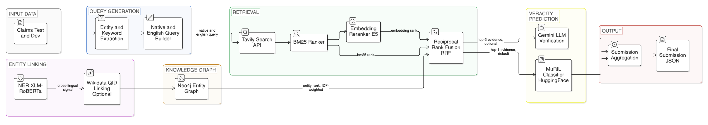
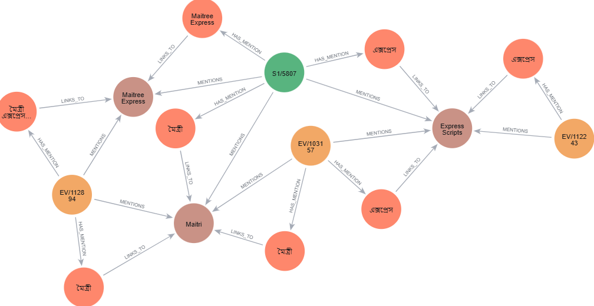
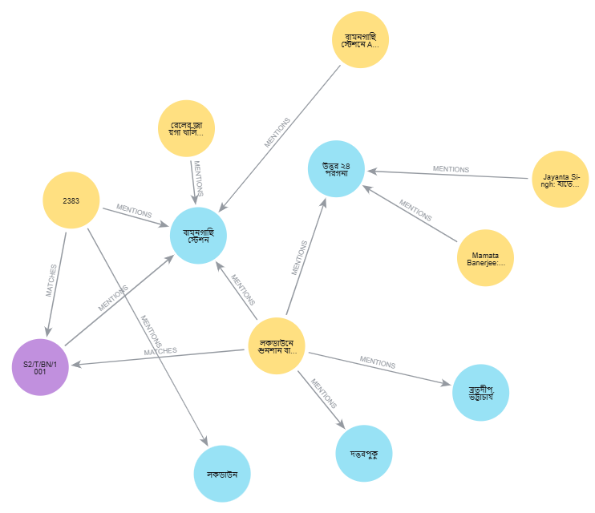

# IndicClaimVer @ FIRE 2026 — Team ClaimSense

Multilingual claim verification (English, Hindi, Bengali, code-mixed) on the IndicClaimBuster dataset. Both subtasks combine BM25, multilingual embeddings and a Neo4j knowledge graph, with a fine-tuned MuRIL veracity classifier.

- **Subtask 1** (closed-domain): retrieve evidence from a fixed pool, rerank with the KG, predict veracity.
- **Subtask 2** (open-domain): search the live web, fuse ranking signals, predict veracity.

## Architecture

**Subtask 1**


**Subtask 2**



## Knowledge Graph (Neo4j)

**Subtask 1**



**Subtask 2**



## Structure

```
subtask1_pipeline/   # Subtask 1 code, data, results
subtask2_pipeline/   # Subtask 2 code, data, output
images/              # diagrams
requirements.txt     # shared dependencies
docker-compose.yml   # shared Neo4j
```

## Setup

```bash
python -m venv venv
venv\Scripts\activate            # source venv/bin/activate on Linux/macOS
pip install -r requirements.txt
docker-compose up -d             # Neo4j at bolt://localhost:7687
```

In each pipeline folder, copy `.env.example` to `.env` and fill in the keys.

## Run

**Subtask 1**

```bash
cd subtask1_pipeline
python subtask1/scripts/03_build_kg_st1.py
python subtask1/scripts/kg_pipeline.py dense
python subtask1/scripts/kg_pipeline.py finalize --with-gpt
```

**Subtask 2**

```bash
cd subtask2_pipeline
python run_pipeline.py
python compute_f1.py --gold data/dev_subtask2.json --pred output/final_submission.json
```

## Model

Fine-tuned MuRIL veracity classifier (SUPPORTS / REFUTES), shared by both subtasks: [nirnit-13/muril-supports-refutes](https://huggingface.co/nirnit-13/muril-supports-refutes)

## Results

**Official test set**

| Subtask | Metric | English | Hindi | Bengali | Code-mixed |
| ------- | ------ | ------- | ----- | ------- | ---------- |
| 1 | Success@3 (retrieval) | 79.58 | 88.67 | 67.00 | 26.67 |
| 1 | Macro-F1 (veracity) | 78.05 | 85.88 | 82.46 | 79.94 |
| 2 | Macro-F1 (veracity) | 76.91 | 68.97 | 62.92 | 36.51 |

**Dev set, veracity Macro-F1**

| Subtask | MuRIL | LLM |
| ------- | ----- | --- |
| 1 (1,134 claims) | 0.848 | 0.908 (GPT-4o-mini) |
| 2 (631 claims) | 0.682 | 0.804 (Gemini) |

KG reranking (Subtask 1) raises dev Success@3 from 0.831 to 0.840 over dense-only retrieval.

## Notes

**Subtask 1 pipeline.** The retriever pulls the top-10 passages per claim with `multilingual-e5-base`, then reranks them using IDF-weighted Wikidata entity overlap from Neo4j. The final top-3 go to either GPT-4o-mini or MuRIL for the verdict. Entity linking runs IndicNER, then a Wikidata lookup, semantic matching, a GPT-4o-mini fallback, Wikipedia redirects and coreference. Keys: `NEO4J_PASSWORD`, `HF_TOKEN`, `OPENAI_API_KEY`.

**KG weight sweep.** `ENTITY_OVERLAP_WEIGHT = 0.02` was picked by a sweep over 0.0–0.05 (`subtask1/experiments/weight_sweep_results.txt`). Every weight from 0.01 to 0.05 beat dense-only retrieval. An event-clustering penalty was also tried, but it made results worse, so it is disabled.

**Subtask 2 pipeline.** Each claim gets a native-language query and an English query, both sent to Tavily. Results are ranked by BM25, embeddings and Neo4j entity overlap, and the three rankings are merged with Reciprocal Rank Fusion. `run_pipeline.py --verifier muril` (default) uses MuRIL on the top-1 snippet, and GPT-4o-mini only writes the justification. `--verifier gemini` fetches the full text of the top 3 sources and verifies with Gemini; this is the setup reported in the paper. Keys: `TAVILY_API_KEY`, `NEO4J_*`, `OPENAI_API_KEY` (justifications), `GEMINI_API_KEY` (Gemini only).

**Backend history (Subtask 2).** Verification started on Gemini, moved to GPT-4o-mini for a while because of Gemini's free-tier quota, and then went back to Gemini via `google-genai`. `openai` is still used, but only for the MuRIL justifications. Gemini results are stored in `output/GPT_output/`, and MuRIL results in `output/classifier_output/`.

**Classifier.** MuRIL was fine-tuned from `google/muril-base-cased` on claim + evidence pairs, with class-weighted loss and hyperparameters tuned with Optuna. Training was done in `notebook/FIRE2026_FINAL.ipynb` and tuning in `notebook/FIRE_2026_HPT_01.ipynb`. The same checkpoint is used in both subtasks without retraining. Its label mapping is `{0: SUPPORTS, 1: REFUTES}`, the opposite of the repo's `config.LABEL2ID`.

**Submission format.** Subtask 1 writes `{ID, top_3_evidence, Prediction}` and Subtask 2 writes `{ID, Evidence, Prediction, Justification}`, as one file per language (`<Language>_subtask{1,2}.json`). `Prediction` must be exactly `SUPPORTS` or `REFUTES`.

## Team

Koushiki Chakraborty, Archismita Das, Anindita Dutta, Nirnit Roy, Sayan De, Imon Mukherjee
