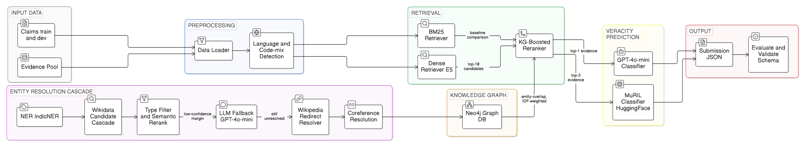
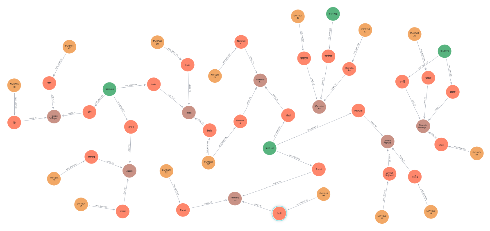

# IndicClaimVer 2026 — Team ClaimSense

Our submission to the **IndicClaimVer@FIRE 2026** shared task: multilingual
(English, Hindi, Bengali, code-mixed) claim verification over the
[IndicClaimBuster](https://aclanthology.org/2025.ijcnlp-long.133/) dataset.
We participated in both subtasks, as two separate pipelines that share a
common design philosophy — combine a lexical signal (BM25), a semantic
signal (multilingual sentence embeddings), and a symbolic, inspectable
signal (a Neo4j knowledge graph) — but are otherwise independent codebases,
since the two subtasks pose genuinely different problems.

## Repository layout

```
requirements.txt        # shared Python dependencies for BOTH pipelines
docker-compose.yml       # shared Neo4j container for BOTH pipelines
.gitignore
images/                  # architecture diagrams + Neo4j graph screenshots (see System Architecture below)

subtask1_pipeline/       # Subtask 1 -- closed-domain evidence retrieval + veracity prediction
  README.md               # full architecture, setup, and results writeup
  subtask1/                # the package -- retrieval, KG reranking, entity linking, veracity
  data/                    # train/dev claims + the fixed evidence pool
  results/                 # dev-set + official-test-set output

subtask2_pipeline/       # Subtask 2 -- open-domain (live web) retrieval + veracity prediction
  README.md               # full architecture, setup, and results writeup
  src/                     # query generation, retrieval, ranking fusion, LLM verification
  data/                    # dev + official test claims (no fixed evidence pool)
  output/                  # per-claim artifacts + final submission

```

**Each pipeline has its own detailed README** — `subtask1_pipeline/README.md`
and `subtask2_pipeline/README.md` — covering the full architecture,
validated ablations, exact reproduction commands, and known limitations
for that subtask specifically. This root README only covers what's shared
between them and how to get started; go to the pipeline-specific README
for anything about how a stage actually works.

## Why two separate pipelines?

Subtask 1 is **closed-domain**: every claim's evidence is guaranteed to
exist somewhere in a fixed, provided pool (~13k passages), so the problem
is purely retrieval + reranking + classification over known data. Subtask 2
is **open-domain**: there is no fixed pool at all — the system must search
the live web itself, decide what's actually relevant, and reason over
whatever it finds. These call for different retrieval architectures (a
closed dense-retrieval + KG-rerank pipeline vs. a live web-search +
multi-signal-fusion pipeline), so rather than force one shared pipeline to
awkwardly cover both settings, we built two, sharing only what's genuinely
common infrastructure: dependencies, the Neo4j container, and — reused
as-is, not retrained — the same fine-tuned MuRIL veracity classifier.

## System Architecture

### Subtask 1 — Closed Evidence Retrieval + Veracity Prediction



### Subtask 2 — Open-Domain Retrieval + Veracity Prediction


### Subtask 1 Knowledge Graph (Neo4j)



Real claims from the production graph — one each for English, Hindi, and
Bengali, plus a genuine Hindi-English code-mixed claim — shown with their
`HAS_MENTION` → `LINKS_TO` Mention/Entity chains and the Evidence items
sharing those same entities.

### Subtask 2 Knowledge Graph (Neo4j)

*(Graph screenshot pending — to be added once Subtask 2's Neo4j instance is populated with test-set data.)*

## Setup (shared)

```bash
python -m venv venv
venv\Scripts\activate          # or `source venv/bin/activate` on Linux/macOS
pip install -r requirements.txt
docker-compose up -d           # starts the shared Neo4j container
                                # (bolt://localhost:7687, browser on :7474)
```

Then go into whichever pipeline you're working on and follow its own
README for that pipeline's `.env` setup and run commands:

```bash
cd subtask1_pipeline   # or subtask2_pipeline
copy .env.example .env
# fill in the keys/passwords that pipeline's README lists as required
```

Both pipelines' `.env.example` files default `NEO4J_PASSWORD` to
`indicclaimver123`, matching the shared `docker-compose.yml` — they're kept
in sync deliberately; if you ever change the Neo4j password, update all
three files together.

**Note on the shared Neo4j container:** the two pipelines use _different_
graph schemas (Subtask 1 keys `Entity` nodes by Wikidata `qid`; Subtask 2
keys them by `normalized_text`) and aren't designed to be queried as one
merged graph. Running both against the same default database is fine for
normal use (their node labels/constraints don't conflict), but if you want
full isolation, set `NEO4J_DATABASE` to a different value in each
pipeline's `.env` — both `Neo4jClient` implementations already support it.

## Results summary

Full validated ablations, per-language breakdowns, and reproduction
commands live in each pipeline's own README. Headline numbers:

**Subtask 1** (official test set, per language, veracity Macro-F1):
English 78.05, Hindi 85.88, Bengali 82.46, Code-mixed 79.94.

**Subtask 2** (official test set, per language, veracity Macro-F1):
English 76.91, Hindi 68.97, Bengali 62.92, Code-mixed **36.51** — the
code-mixed collapse here is the single most notable finding across both
subtasks; see `subtask2_pipeline/README.md`

On both subtasks, LLM-based veracity prediction (GPT-4o-mini for Subtask 1,
Gemini for Subtask 2) meaningfully outperforms the reused, fine-tuned MuRIL
classifier on our own internal dev-set comparisons — see each pipeline's
README for the exact numbers and the same-basis comparison methodology.

## Required citation

Both subtasks are built on the IndicClaimBuster dataset. If you use this
code or cite this work, please also cite:

```bibtex
@inproceedings{pal-etal-2025-indicclaimbuster,
    title = "{I}ndic{C}laim{B}uster: A Multilingual Claim Verification Dataset",
    author = "Pal, Pritam and Jana, Shyamal Krishna and Das, Dipankar",
    booktitle = "Proceedings of the 14th International Joint Conference on Natural Language Processing and the 4th Conference of the Asia-Pacific Chapter of the Association for Computational Linguistics",
    month = dec,
    year = "2025",
    address = "Mumbai, India",
    publisher = "The Asian Federation of Natural Language Processing and The Association for Computational Linguistics",
    pages = "2478--2489",
    url = "https://aclanthology.org/2025.ijcnlp-long.133/",
    doi = "10.18653/v1/2025.ijcnlp-long.133"
}
```

## Contributors

Sayan De, Koushiki Chakraborty,Archismita Das, Nirnit Roy, Anindita Dutta
