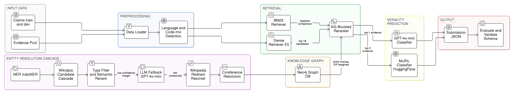
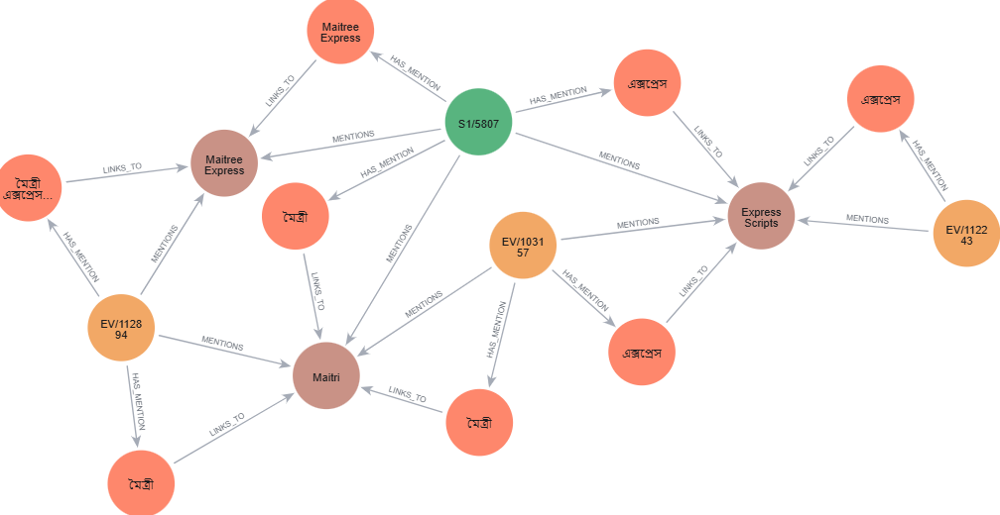

# Subtask 1: Closed Domain Claim Verification

For each claim, retrieve the top 3 passages from a fixed evidence pool, then predict `SUPPORTS` or `REFUTES`.



## Method

1. **Dense retrieval.** `intfloat/multilingual-e5-base` embeds claims and evidence. The top 10 passages are retrieved from the evidence of the claim's detected script (Bengali, Devanagari or Latin).
2. **Entity linking.** IndicNER, then a Wikidata lookup, semantic matching, a GPT-4o-mini fallback, Wikipedia redirects and coreference. Linked entities become `Entity` nodes in Neo4j, keyed by Wikidata QID.
3. **KG rerank.** Each candidate's dense score is increased by `ENTITY_OVERLAP_WEIGHT × Σ 1 / log(df + e)` over the entities it shares with the claim, where `df` is the number of documents that mention the entity. The top 3 after reranking are kept.
4. **Verdict.** GPT-4o-mini or the fine-tuned MuRIL classifier (see [`../classifier`](../classifier/README.md)) reads the claim and the top 3 passages.



## Layout

```
subtask1_pipeline/
├── config.py                  models, weights, top k, paths
├── .env.example
├── data/                      train_subtask1.json, dev_subtask1.json, evidence_pool.json
└── subtask1/
    ├── data_loader.py         loading and script based language detection
    ├── embeddings.py          e5 encoding and caching
    ├── retriever.py           BM25, dense and KG boosted retrievers
    ├── integrated_pipeline.py entity linking cascade
    ├── entity_linker.py
    ├── kg_builder_st1.py      writes Evidence, Claim and Entity nodes to Neo4j
    ├── event_clustering.py    EventCluster nodes (experiment only)
    ├── nli_reranker.py        mDeBERTa NLI rerank (experiment only)
    ├── dense_gpt_classifier.py GPT-4o-mini verdicts
    ├── muril_classifier.py    MuRIL verdicts (loads the checkpoint from the Hub)
    ├── evaluate.py            Success@3, nDCG@3, Macro-F1
    ├── scripts/               dev set entry points
    ├── officialTestData/      test claims, test evidence pool, test entry points
    ├── experiments/           KG weight sweep, cluster penalty experiment
    ├── notebook/              Colab notebooks for BGE-M3 and IndicSBERT retrieval
    └── results/
        ├── devResult/         one folder per method (bm25, dense, kg, kg_gpt, kg_classifier, ...)
        ├── testResult/        kg, kg_gpt, kg_classifier on the official test set
        └── score/             final dev scores, see score/score_summary.md
```

## Running on the dev set

Run from `subtask1_pipeline/` with Neo4j up and `.env` filled in.

```bash
# 1. Checks and baseline (optional)
python subtask1/scripts/00_setup_neo4j_schema.py
python subtask1/scripts/01_gate1_connectivity_check.py      # Neo4j and model access
python subtask1/scripts/02_gate2_bm25_baseline_and_validation.py

# 2. Evidence nodes and embeddings
python subtask1/scripts/03_build_kg_st1.py

# 3. Dense top 10 for every train and dev claim
python subtask1/scripts/kg_pipeline.py dense

# 4. Entity linking, split across N processes (example: 4 shards)
SHARD_INDEX=0 SHARD_COUNT=4 python subtask1/scripts/kg_pipeline.py shard
SHARD_INDEX=1 SHARD_COUNT=4 python subtask1/scripts/kg_pipeline.py shard
SHARD_INDEX=2 SHARD_COUNT=4 python subtask1/scripts/kg_pipeline.py shard
SHARD_INDEX=3 SHARD_COUNT=4 python subtask1/scripts/kg_pipeline.py shard
python subtask1/scripts/merge_shard_caches.py

# 5. KG rerank, scoring, and optional GPT-4o-mini verdicts
python subtask1/scripts/kg_pipeline.py finalize --with-gpt

# MuRIL verdicts instead of GPT-4o-mini
python subtask1/scripts/07_eval_full_pipeline_st1.py
```

`kg_pipeline.py cluster` builds `EventCluster` nodes. They are only used by the cluster penalty experiment, which is disabled in the final system.

Outputs go to `subtask1/results/devResult/kg/` (retrieval) and `kg_gpt/` (verdicts). Intermediate files go to the gitignored `cache/` folder.

## Running on the official test set

The test pool is loaded into a separate Neo4j database so it cannot mix with train and dev evidence.

```bash
export NEO4J_DATABASE=testkg
python subtask1/officialTestData/scripts/prepare_test_files.py   # merges the 4 language files
python subtask1/officialTestData/scripts/kg_pipeline.py setup
python subtask1/officialTestData/scripts/kg_pipeline.py dense
SHARD_INDEX=0 SHARD_COUNT=4 python subtask1/officialTestData/scripts/kg_pipeline.py shard   # repeat for 1, 2, 3
python subtask1/officialTestData/scripts/kg_pipeline.py finalize --with-gpt
```

Results go to `subtask1/results/testResult/`. The per-language submission files are in `testResult/kg_gpt/submission_by_language/` and `testResult/kg_classifier/submission_by_language/`. The MuRIL test predictions were made with [`../classifier/notebooks/02_predict_on_kg_top3.ipynb`](../classifier/notebooks/).

## Results

**Retrieval, train + dev (5,670 claims)**

| Retriever | Success@3 | nDCG@3 |
| --------- | --------: | -----: |
| IndicSBERT | 0.614 | 0.430 |
| BGE-M3 | 0.832 | 0.512 |
| Dense, multilingual-e5-base | 0.831 | 0.571 |
| Dense + KG rerank (final) | **0.840** | **0.575** |

BM25 on the dev split alone (1,134 claims) reaches Success@3 0.768 and nDCG@3 0.563.

**Final retrieval by language, train + dev**

| Language | Success@3 | nDCG@3 | Claims |
| -------- | --------: | -----: | -----: |
| Hindi | 0.883 | 0.568 | 1,432 |
| Bengali | 0.756 | 0.547 | 978 |
| English | 0.889 | 0.635 | 1,967 |
| Code-mixed | 0.780 | 0.512 | 1,293 |

**Veracity on the KG top 3, dev (1,134 claims)**

| Model | Accuracy | Macro-F1 | F1 SUPPORTS | F1 REFUTES |
| ----- | -------: | -------: | ----------: | ---------: |
| MuRIL | 0.866 | 0.848 | 0.900 | 0.796 |
| GPT-4o-mini | 0.920 | 0.908 | 0.941 | 0.874 |

## Experiments

* **KG weight sweep** (`experiments/kg_weight_sweep.py`, results in `weight_sweep_results.txt`). Weights from 0.0 to 0.05 were tested. Every weight from 0.01 to 0.05 beat dense retrieval alone, and 0.02 was best.
* **IDF weighting.** A plain count of shared entities did worse than dense retrieval (Success@3 0.783 vs 0.831), because very common entities dominated. Weighting by inverse document frequency fixed this.
* **Event cluster penalty** (`experiments/kg_cluster_penalty_experiment.py`). Lowered scores, so it is disabled.
* **NLI rerank** (`scripts/nli_rerank_pipeline.py`). Tried on a small sample only, not used.
