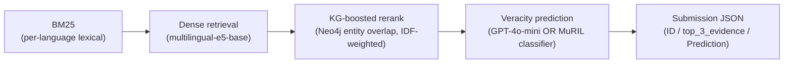

# IndicClaimVer Subtask 1 — Evidence Selection + Veracity Prediction (FIRE 2026)

A retrieval + fact-verification pipeline for FIRE 2026 IndicClaimVer **Subtask 1**
(closed evidence setting). For every claim — in English, Hindi, Bengali, or
CodeMix — the pipeline retrieves the top-3 most relevant passages from a fixed
evidence pool and predicts whether the claim is `SUPPORTS`ed or `REFUTES`d by
that evidence.

This is **not** the open-domain Subtask 2 (web retrieval + LLM verification) —
everything here works over a closed, provided evidence pool (`data/evidence_pool.json`),
using BM25, dense embeddings, and a Neo4j knowledge graph, not live web search.

## Task recap

- Input: a claim (`ID`, `Text`), plus a fixed pool of evidence passages (`ID`, `Evidence`).
- Output per claim: the 3 evidence passages ranked most-to-least relevant, plus
  one veracity label (`SUPPORTS` or `REFUTES`).
- Scored on retrieval quality (Success@3, nDCG@3 against the gold evidence
  item) and veracity accuracy/macro-F1 against the gold label.

## Repository layout

```
config.py                      # centralized settings: paths, model names, tunable weights
.env.example

# ../requirements.txt and ../docker-compose.yml (repo root) are SHARED
# with subtask2_pipeline -- see the root README.md. Both pipelines were
# merged into one requirements.txt / one Neo4j container in 2026-08
# since each had its own copy that was never meant to run independently
# (identical container name + ports meant the two docker-compose.yml
# files could never actually run at the same time anyway).

data/                          # train/dev claims + evidence pool (provided)
  train_subtask1.json          # 4536 claims, with gold Evidence + Label
  dev_subtask1.json            # 1134 claims, with gold Evidence + Label
  evidence_pool.json           # ~13k evidence passages, no gold labels

subtask1/                      # the package -- all pipeline code lives here
  data_loader.py                # JSON loading, language detection, code-mixed detection
  embeddings.py                 # E5 sentence-embedding encode/cache, dense retrieval
  retriever.py                  # BM25Retriever, DenseRetriever, KGBoostedRetriever
  entity_linker.py               # NER + Wikidata SPARQL linking primitives
  integrated_pipeline.py         # full entity-resolution cascade (candidates, ranking,
                                  # semantic rerank, LLM fallback, coreference) -- large
  kg_builder_st1.py              # ingests Claim/Evidence/Entity/Mention nodes into Neo4j
  neo4j_client.py                # thin Neo4j driver wrapper + schema setup
  event_clustering.py            # DBSCAN event clustering (validated NOT to help -- disabled)
  nli_reranker.py                # NLI-based reranking (mDeBERTa) -- alternative path, unused in production
  dense_gpt_classifier.py        # GPT-4o-mini veracity classification over retrieved evidence
  muril_classifier.py            # VeracityPredictor -- loads the fine-tuned MuRIL checkpoint
                                  # (config.MURIL_CLASSIFIER_MODEL) straight from HuggingFace, inference only
  dense_retrieval_report.py      # writes evidence-only (no Prediction) result reports
  evaluate.py                    # Success@k, nDCG@k, macro-F1, official submission-schema validation

  scripts/                       # entry points -- run these, don't import subtask1/*.py directly
    00_setup_neo4j_schema.py
    01_gate1_connectivity_check.py   # verify Neo4j / Wikidata / HuggingFace / Wikipedia reachability
    02_gate2_bm25_baseline_and_validation.py  # BM25 vs Dense baseline, per-language
    03_build_kg_st1.py               # build the Neo4j KG (Evidence/Claim/Entity nodes, linking)
    07_eval_full_pipeline_st1.py     # KG-boosted top-3 retrieval + MuRIL veracity, loaded from
                                      # HuggingFace via muril_classifier.py -- writes
                                      # results/devResult/kg_classifier/{final_predictions,submission,evaluation_metrics}.json
    kg_pipeline.py                   # main dev/train pipeline: dense / shard / cluster / finalize
    dense_only_top3.py               # writes a Dense-only (no KG) evidence report
    dense_gpt_pipeline.py            # Dense retrieval + GPT-4o-mini veracity
    nli_rerank_pipeline.py           # NLI-reranked retrieval + GPT-4o-mini veracity
    bge_m3_retrieval.py              # BGE-M3 dense retrieval, alternate embedding model
    merge_shard_caches.py            # merge per-shard entity-linking caches after a sharded run
    probe_neo4j_evidence_nodes.py    # diagnostic: check Evidence node population
    verify_lang_match.py             # diagnostic: claim/evidence language-mismatch audit
    compare_ner_fix.py               # diagnostic: old vs new NER extraction comparison

  experiments/                   # exploratory only -- not imported by the real pipeline
    kg_weighted_overlap_reranker.py / _pipeline.py / kg_weight_sweep.py
    kg_cluster_penalty_experiment.py
    README.md                      # full write-up of both experiments + validated numbers

  notebook/                      # classifier training notebooks (Colab)
    FIRE_2026_HPT_01.ipynb           # Optuna hyperparameter search
    FIRE2026_FINAL.ipynb             # final MuRIL classifier training + dev eval
    FIRE_2026_KG_Final_Predictions.ipynb
  bge_m3_colab.ipynb / indic_sbert_colab.ipynb / train_classifier_colab.ipynb

  officialTestData/              # official FIRE 2026 test set + its own pipeline copy
    data/                           # per-language test claims + evidence_pool_test(_fixed).json
    scripts/                        # prepare_test_files.py, kg_pipeline.py, dense_only_top3.py,
                                     # dense_gpt_pipeline.py -- same stages as subtask1/scripts/,
                                     # pointed at the official test files instead of data/
    results/                        # this pipeline's own raw output (kg/, kg_classifier/, kg_gpt/)

  results/                       # dev-set (train+dev) evaluation output + official test output
    devResult/                     # ALL dev/train+dev pipeline results live here
      bm25/ dense/ dense_full_pool/ dense_gpt/ dense_partitioned/  # retrieval baselines
      kg/ kg_gpt/                  # KG-boosted retrieval, and +GPT-4o-mini veracity
      kg_classifier/                # standalone MuRIL classifier predictions + evaluation_metrics.json
      make_submission.py            # combines kg/result.json + kg_classifier/final_predictions.json
      score/                        # (currently empty -- reserved for future dev-score exports)
    testResult/                    # official-test-set output, mirrors officialTestData/results/
      kg/ kg_classifier/ kg_gpt/     # copied from officialTestData/results/ (kg/kg_gpt regenerated
                                      # directly here by officialTestData/scripts/*; kg_classifier/
                                      # has no producing script in this repo -- built externally)
    score/                         # consolidated, human-readable score summary -- see below
```

## Pipeline stages



1. **BM25** (`retriever.py::BM25Retriever`) — per-language lexical baseline, `rank_bm25`.
2. **Dense retrieval** (`embeddings.py`, `retriever.py::DenseRetriever`) — cosine
   similarity over `intfloat/multilingual-e5-base` embeddings (E5 query/passage
   prefixing applied automatically), either NumPy-backed or Neo4j-backed.
3. **KG-boosted rerank** (`retriever.py::KGBoostedRetriever`, `kg_builder_st1.py`) —
   reranks Dense's top-10 by entity overlap with a Neo4j graph of
   `Claim`/`Evidence`/`Entity`/`Mention` nodes, weighted by inverse document
   frequency (`config.ENTITY_OVERLAP_WEIGHT = 0.02`, validated by a weight
   sweep — see `experiments/README.md`). Entity linking itself
   (`integrated_pipeline.py`) is NER → multi-stage Wikidata candidate
   cascade → type-aware filtering → semantic rerank → optional two-tier
   GPT-4o-mini fallback → Wikipedia-redirect resolver → same-document PER
   coreference.
4. **Event clustering** (`event_clustering.py`) — DBSCAN-based disambiguation
   signal; empirically validated to make results *worse* at production scale
   (see Known limitations) and is disabled in the active scoring path.
5. **Veracity prediction** — two independent, not-yet-merged paths:
   - `dense_gpt_classifier.py`: GPT-4o-mini predicts SUPPORTS/REFUTES from the
     top-1 retrieved evidence. This is the path wired into `kg_pipeline.py finalize --with-gpt`.
   - A standalone `google/muril-base-cased` binary classifier, fine-tuned in
     `notebook/FIRE2026_FINAL.ipynb` and published to HuggingFace
     ([nirnit-13/muril-supports-refutes](https://huggingface.co/nirnit-13/muril-supports-refutes)).
     `muril_classifier.py::VeracityPredictor` loads it for inference; there
     is no training `.py` module (training only ever happened in the
     notebook). This is the path `scripts/07_eval_full_pipeline_st1.py`
     runs, writing to `kg_classifier/`.
6. **Submission** (`evaluate.py`) — validates and writes the official schema:
   `{"ID", "top_3_evidence": [text, text, text], "Prediction": "SUPPORTS"|"REFUTES"}`.

## Setup

```bash
python -m venv venv
venv\Scripts\activate
pip install -r ../requirements.txt   # shared with subtask2_pipeline, see repo root
copy .env.example .env      # then fill in NEO4J_PASSWORD, HF_TOKEN, OPENAI_API_KEY
cd .. && docker-compose up -d && cd subtask1_pipeline  # starts the shared Neo4j
                                                        # container (bolt://localhost:7687, browser on :7474)
```

`.env.example`'s default `NEO4J_PASSWORD` (`indicclaimver123`) now matches
the shared `../docker-compose.yml`'s `NEO4J_AUTH` password -- previously
these were out of sync (`Nirnit@2005` in this pipeline's own, now-removed
docker-compose.yml) and Neo4j auth would fail until someone noticed; fixed
when the two pipelines' Neo4j containers were merged into one (2026-08).

`NER_MODEL` (`ai4bharat/IndicNER`) and `GEN_MODEL` are gated on HuggingFace —
accept each model's license while logged in, then set `HF_TOKEN` or run
`huggingface-cli login`.

Run `python subtask1/scripts/01_gate1_connectivity_check.py` first — it
checks Neo4j, Wikidata SPARQL, HuggingFace Hub, and Wikipedia reachability
before anything else runs.

## Running the pipeline

**Dev/train evaluation** (`data/`):
```bash
python subtask1/scripts/02_gate2_bm25_baseline_and_validation.py   # BM25 vs Dense baseline
python subtask1/scripts/03_build_kg_st1.py                          # build the Neo4j KG
python subtask1/scripts/kg_pipeline.py dense                        # Dense top-10 per claim
python subtask1/scripts/kg_pipeline.py finalize --with-gpt          # KG-boosted top-3 + GPT veracity
python subtask1/scripts/07_eval_full_pipeline_st1.py                # KG-boosted top-3 + MuRIL veracity (HuggingFace)
```
Output lands in `subtask1/results/devResult/`.

**Official test set** (`subtask1/officialTestData/`):
```bash
python subtask1/officialTestData/scripts/prepare_test_files.py      # combine per-language files
python subtask1/officialTestData/scripts/kg_pipeline.py setup       # Evidence + Claim nodes (testkg db)
python subtask1/officialTestData/scripts/kg_pipeline.py dense
python subtask1/officialTestData/scripts/kg_pipeline.py finalize --with-gpt
```
Output lands in `subtask1/results/testResult/` (redirected there from the
scripts' own `officialTestData/results/`, which stays as a local working copy).

Sharded entity linking (`kg_pipeline.py shard`, `officialTestData/scripts/kg_pipeline.py shard`)
supports running multiple parallel processes against the same graph — set
`SHARD_INDEX`/`SHARD_COUNT` env vars, then merge caches with
`subtask1/scripts/merge_shard_caches.py` once all shards finish.

## Validated dev-set metrics

Retrieval (Success@3 / nDCG@3), per language:

| Method | Scope (n) | Hindi | Bengali | English | Code-mixed | Overall |
|---|---|---|---|---|---|---|
| BM25 | 1134 (dev) | 0.889 / 0.607 | 0.670 / 0.488 | 0.796 / 0.629 | 0.662 / 0.470 | 0.768 / 0.563 |
| Dense (full-pool) | 1134 (dev) | 0.875 / 0.584 | 0.682 / 0.488 | 0.869 / 0.623 | 0.773 / 0.512 | 0.818 / 0.566 |
| Dense (partitioned) | 1134 (dev) | 0.875 / 0.575 | 0.687 / 0.490 | 0.874 / 0.626 | 0.773 / 0.512 | 0.821 / 0.565 |
| Dense-only | 5670 (train+dev) | 0.882 / 0.567 | 0.739 / 0.539 | 0.882 / 0.634 | 0.767 / 0.505 | 0.831 / 0.571 |
| **KG-boosted** | 5670 (train+dev) | 0.883 / 0.568 | 0.756 / 0.547 | 0.889 / 0.635 | 0.780 / 0.512 | **0.8395 / 0.5748** |

KG-boosted beats Dense-only on both metrics, at every weight in `[0.01, 0.05]`
tried for `ENTITY_OVERLAP_WEIGHT` — see `subtask1/experiments/README.md` for
the full sweep. Bengali and Code-mixed are consistently the weakest buckets
across every method (known multilingual-embedding weak point).

Veracity, both scored on the same KG-boosted top-3 evidence:

| Model | Scope (n) | Accuracy | Macro F1 |
|---|---|---|---|
| MuRIL classifier | 1134 (dev only) | 0.8660 | 0.8480 |
| GPT-4o-mini | 1134 (dev only) | **0.9198** | **0.9075** |
| GPT-4o-mini (as originally reported) | 5670 (train+dev) | — | 0.9236 |

Full derivation and per-class precision/recall is in `subtask1/results/score/score_summary.md`.

## Submission format (official spec)

One JSON array per language, filename `<Language>_subtask1.json` (e.g.
`English_subtask1.json`, `Hindi_subtask1.json`, `Bengali_subtask1.json`,
`CodeMix_subtask1.json`):

```json
[
  {
    "ID": "S1/4530",
    "top_3_evidence": ["Evidence 1", "Evidence 2", "Evidence 3"],
    "Prediction": "SUPPORTS"
  }
]
```

- `top_3_evidence` = exactly 3 evidence **texts** (not IDs), most-to-least relevant.
- `Prediction` is case-sensitive, exactly `SUPPORTS` or `REFUTES`.
- Every test claim ID appears exactly once — no missing/duplicate/unknown IDs.
- `evaluate.py::validate_submission()` enforces all of this before writing.

`subtask1/officialTestData/results/kg_classifier/submission_by_language/` and
`kg_gpt/submission_by_language/` already contain files in this exact naming
convention.

## Known limitations

- **Event clustering is validated but disabled** — a cluster-density penalty
  on top of KG-boosted scoring was tried and made both Success@3 and nDCG@3
  *strictly worse* at every nonzero weight tried, because DBSCAN at the
  current threshold collapses into one giant cluster per language rather
  than isolating genuinely confusable sub-events (see `experiments/README.md`).
- **Classifier metric discrepancy, unresolved**: `subtask1/results/devResult/kg_classifier/evaluation_metrics.json`
  reports Accuracy=0.8660/Macro F1=0.8480, which does not match either of two
  different numbers previously circulated for the same classifier — worth
  confirming which run is authoritative before citing a number externally.
  Re-running `scripts/07_eval_full_pipeline_st1.py` regenerates this file
  from the tracked pipeline + the published checkpoint, so a fresh number
  is always reproducible going forward.
- `nli_reranker.py`/`scripts/nli_rerank_pipeline.py` (NLI-based reranking)
  and the BGE-M3/IndicSBERT embedding notebooks (`bge_m3_colab.ipynb`,
  `indic_sbert_colab.ipynb`) are exploratory comparisons only, not part of
  the production path — `results/devResult/nli_rerank/summary.txt` in
  particular only ever ran on a 10-claim smoke sample (n=10), not the full
  train+dev set; don't cite its numbers as representative.

## Classifier model details

Standalone binary claim-evidence verifier, fine-tuned from `google/muril-base-cased`.
Checkpoint: [nirnit-13/muril-supports-refutes](https://huggingface.co/nirnit-13/muril-supports-refutes).
Input: claim + candidate evidence text, `max_length=192`, `fp16=True`,
class-weighted cross-entropy for the SUPPORTS/REFUTES imbalance (train set:
3040 SUPPORTS / 1496 REFUTES). Best suited for informal, code-mixed
Hindi–Bengali–English text; degrades on more formal/out-of-domain evidence.
This is a separate prediction path from the GPT-4o-mini path and is not
merged into a single default submission.

There is no training script for this model in the repo — it was fine-tuned
in `notebook/FIRE2026_FINAL.ipynb` (hyperparameters found by
`notebook/FIRE_2026_HPT_01.ipynb`'s Optuna search) and the resulting
checkpoint uploaded to the Hub. `subtask1/muril_classifier.py::VeracityPredictor`
loads it directly from there (`config.MURIL_CLASSIFIER_MODEL`, overridable
via the `MURIL_CLASSIFIER_MODEL` env var) — this is what
`scripts/07_eval_full_pipeline_st1.py` runs for inference. Its label
mapping is read from the checkpoint's own `config.id2label`
(`{0: "SUPPORTS", 1: "REFUTES"}`), which is the *opposite* of this repo's
own `config.LABEL2ID` (`{"REFUTES": 0, "SUPPORTS": 1}`, used only for
class-weight bookkeeping) — a real, easy-to-trip-on mismatch if either
constant is ever assumed to apply to the other.
