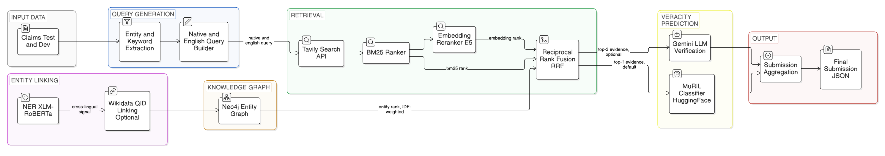
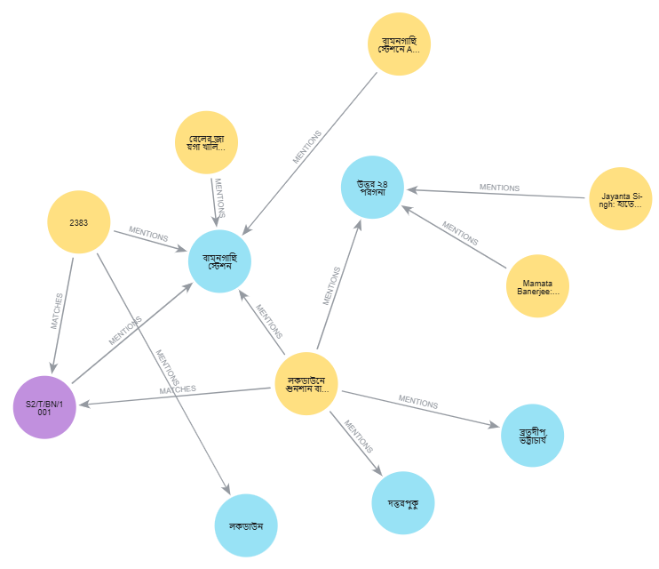

# Subtask 2: Open Domain Claim Verification

For each claim, search the live web, rank the results, and predict `SUPPORTS` or `REFUTES` with a short justification.



## Method

| Stage | Module | What it does |
| ----- | ------ | ------------ |
| 1. Query generation | `src/query_generation.py` | Builds a native-language query and an English query from the claim's entities and keywords |
| 2. Web search | `src/retrieval.py` | Sends both queries to Tavily and merges the results |
| 3. BM25 ranking | `src/bm25.py` | Lexical ranking of the search results |
| 4. Embedding ranking | `src/embedding_rerank.py` | Multilingual embedding similarity ranking |
| 5. Entity ranking | `src/entity_graph.py` | Extracts entities, writes them to Neo4j, ranks by entity overlap with the claim |
| 6. Fusion | `src/fusion_ranking.py` | Reciprocal Rank Fusion of the three rankings (k = 60) |
| 7. Verification | `src/muril_classifier.py` or `src/verification.py` | MuRIL on the top result, or Gemini on the full text of the top 3 pages |
| 8. Submission | `src/build_submission.py` | Writes the per-language submission files |

Stages 1 to 3 run inside `src/pipeline.py`. `run_pipeline.py` calls every stage in order.



## Layout

```
subtask2_pipeline/
├── run_pipeline.py        single entry point
├── compute_f1.py          Macro-F1 against a gold file
├── .env.example
├── data/                  dev_subtask2.json and the 4 test files
├── src/                   one module per stage, plus config.py
└── output/
    ├── claims/            test run: one folder per claim with every stage's output
    ├── claims_dev/        dev run: same structure
    ├── GPT_output/        Gemini verifier: dev_submission.json, dev_metrics.json, language_outputs/
    └── classifier_output/ MuRIL verifier: dev_submission.json, dev_metrics.json, language_outputs/
```

Each claim folder holds `retrieval_output.json`, `bm25_ranked.json`, `embedding_ranked.json`, `entity_ranked.json`, `fusion_ranked.json` and `verification_output.json`.

## Running

Run from `subtask2_pipeline/` with Neo4j up and `.env` filled in.

```bash
# Test set, all 4 languages (MuRIL verifier by default)
python run_pipeline.py

# Gemini verifier, as reported in the paper
python run_pipeline.py --verifier gemini

# One language, or a few claims for a quick check
python run_pipeline.py --language hindi
python run_pipeline.py --limit 5

# Dev set
python run_pipeline.py --dataset-file data/dev_subtask2.json --verifier gemini

# Score a dev submission
python compute_f1.py --gold data/dev_subtask2.json --pred output/GPT_output/dev_submission.json
```

| Flag | Meaning |
| ---- | ------- |
| `--verifier {muril,gemini}` | Verification backend. Default `muril` |
| `--language {english,hindi,bengali,codemix}` | Run one test language |
| `--claim-id ID` | Run one claim; repeat for more |
| `--limit N` | Stop after N claims |
| `--dataset-file PATH` | Run on another claims file, such as the dev set |
| `--claims-dir`, `--output-file` | Override output locations |
| `--no-skip-existing` | Recompute stages whose output already exists |

Runs are resumable: a stage is skipped for a claim if its output file already exists. Claims that fail are logged to `output/failed_claims.log` and the run continues.

## Verifiers

* **MuRIL** (default). Classifies the claim against the title and snippet of the top fused result. No retraining on Subtask 2 data. When `OPENAI_API_KEY` is set, GPT-4o-mini writes the justification for the predicted label; otherwise a template is used.
* **Gemini.** Fetches the full text of the top 3 fused results with trafilatura and asks Gemini for a grounded verdict and justification.

Verification started on Gemini, moved to GPT-4o-mini for a while because of Gemini's free tier quota, and then returned to Gemini via `google-genai`. The `openai` package is still used, but only for the MuRIL justifications.

## Results, dev (631 claims)

| Verifier | Accuracy | Macro-F1 | F1 SUPPORTS | F1 REFUTES |
| -------- | -------: | -------: | ----------: | ---------: |
| MuRIL | 0.700 | 0.682 | 0.759 | 0.605 |
| Gemini | 0.808 | 0.804 | 0.833 | 0.775 |

Test results by language are in the [root README](../README.md#results).
