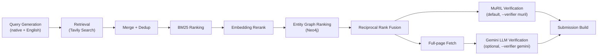
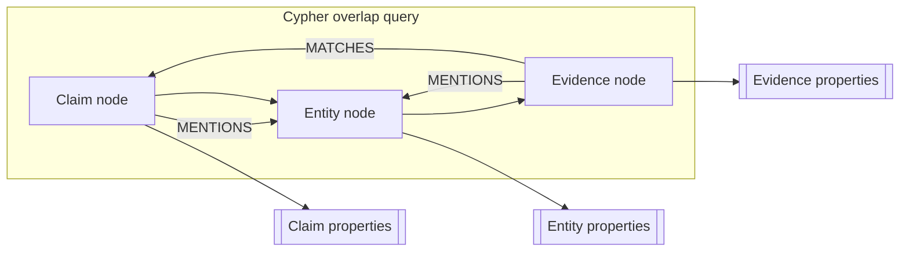

# Subtask 2 Pipeline — Knowledge-Graph Fact Verification for FIRE 2026

A full end-to-end fact verification pipeline built for FIRE 2026 IndicClaimVer Subtask 2. This repository processes claims in English, Hindi, Bengali, and CodeMix through retrieval, lexical ranking, semantic reranking, a Neo4j knowledge graph, fusion ranking, veracity verification (MuRIL by default, or Gemini via `--verifier gemini`), and final submission generation.

## Key Features

- Multi-language claim processing: English, Hindi, Bengali, CodeMix
- Native + English query generation with deterministic entity-aware text processing
- Web retrieval via Tavily Search API with news bias and deduplication
- BM25 lexical ranking over merged retrieval results
- Semantic reranking using multilingual sentence embeddings
- Persisted Neo4j entity graph ranking with claim/evidence/entity nodes
- Reciprocal Rank Fusion (RRF) over BM25, embedding, and entity graph ranks
- Two interchangeable verification backends behind one `--verifier` flag
  on `run_pipeline.py`, both writing the identical submission schema:
  - **`muril` (default)** — the fine-tuned MuRIL classifier decides
    `Prediction`; no API key needed for that. `Justification` is a real,
    evidence-grounded explanation from GPT-4o-mini via
    `src/gpt_justifier.py` (falls back to a flat template if
    `OPENAI_API_KEY` isn't set). This is the actual backend used for
    testing and for the final submission.
  - `gemini` (optional) — strict grounded LLM verification over the
    top-3 fused evidence sources' full article text, kept available for
    generating comparison numbers.
- Resumable batch runs with per-claim output checkpoints

## Why a Knowledge Graph?

The knowledge graph adds a transparent, entity-level ranking signal that complements lexical and semantic retrieval. By representing claims, evidence, and extracted entities in Neo4j, the pipeline can:

- surface evidence items that share meaningful entities with a claim
- normalize multilingual and inflected entity forms
- persist cross-claim and cross-evidence relationships for analysis
- use Wikidata QIDs as an optional additive signal to resolve cross-script matches

This symbolic signal is fused with BM25 and embedding ranks, not used alone. That makes the final ranking more robust and easier to inspect than a pure neural reranker.

## Repository Structure

- `run_pipeline.py` — full end-to-end orchestrator
- `src/pipeline.py` — retrieval + merge + BM25 staging
- `src/query_generation.py` — native + English query builder
- `src/retrieval.py` — Tavily Search API client
- `src/merge_dedup.py` — merge and deduplicate retrieval results
- `src/bm25.py` — lexical BM25 ranking
- `src/embedding_rerank.py` — semantic reranking with sentence embeddings
- `src/entity_extraction.py` — entity extraction and normalization
- `src/entity_graph.py` — Neo4j graph ranking and MATCHES recording
- `src/fusion_ranking.py` — Reciprocal Rank Fusion over three rank signals
- `src/article_fetcher.py` — full-article extraction from URLs
- `src/verification.py` — grounded Gemini LLM prediction and justification (`--verifier gemini`, optional comparison path — not the default)
- `src/build_submission.py` — aggregate per-claim outputs into final submission
- `src/muril_classifier.py` — the MuRIL SUPPORTS/REFUTES classifier, loaded from HuggingFace. **This is `run_pipeline.py`'s default verification backend** (`--verifier muril`); see "Classifier Model Details"
- `src/run_classifier_pipeline.py` — standalone script: runs the MuRIL classifier over already-computed `fusion_ranked.json` files without going through `run_pipeline.py` (used for dev-set metrics and for regenerating the 4 official per-language test files directly)
- `src/gpt_justifier.py` — GPT-4o-mini justification generator for an already-decided MuRIL prediction (explains, never reclassifies). Used both by `run_pipeline.py`'s default `muril` verifier and by `regenerate_classifier_justifications.py` below
- `src/regenerate_classifier_justifications.py` — applies `gpt_justifier.py` to every existing `run_classifier_pipeline.py` output record, in place
- `src/config.py` — centralized configuration and environment variables
- `data/` — claim test/dev datasets
- `output/` — per-claim artifacts, final submission, and logs
- `../requirements.txt`, `../docker-compose.yml` (repo root) — shared with
  subtask1_pipeline; see the root README.md. Merged in 2026-08 -- each
  pipeline previously had its own copy, but both defined the identical
  Neo4j container name and host ports, so they could never actually run
  at the same time anyway.

## Data Files

| Path | Description |
|---|---|
| `data/subtask2_english_test.json` | English test claims |
| `data/subtask2_hindi_test.json` | Hindi test claims |
| `data/subtask2_bengali_test.json` | Bengali test claims |
| `data/subtask2_codemix_test.json` | CodeMix test claims |
| `data/dev_subtask2.json` | 631-claim development set with gold labels |

## Pipeline Overview

The run order in `run_pipeline.py` is intentionally aligned with the repository's actual dependency structure:

1. Query generation + retrieval + BM25 ranking
2. Embedding-based reranking
3. Entity graph ranking
4. Reciprocal Rank Fusion
5. Verification — **`muril` (default)**: MuRIL Prediction + GPT-4o-mini
   Justification, no full-page fetch; **`gemini`** (`--verifier gemini`):
   full-page fetch + grounded LLM verification, kept for comparison
6. Final submission aggregation



### 1. Query generation + retrieval + BM25

`src/pipeline.py` is a pure orchestrator for claim-level retrieval and ranking. For each claim it:

- loads the claim text and language tag
- calls `src/query_generation.py` to produce:
  - `native_query`
  - `english_query`
  - `english_translation`
- retrieves search results from `src/retrieval.py` using both queries
- merges and deduplicates results via `src/merge_dedup.py`
- ranks merged results with `src/bm25.py`
- saves two per-claim files in `output/claims/<claim_id>`:
  - `retrieval_output.json`
  - `bm25_ranked.json`

### 2. Embedding reranking

`src/embedding_rerank.py` reads the claim's English translation and BM25-ranked evidence items, embeds them with a multilingual sentence-transformer model, and produces:

- `embedding_score_raw`
- `embedding_score_norm`
- `embedding_rank`

Preferred model: `intfloat/multilingual-e5-base`
Fallback: `BAAI/bge-base-en-v1.5`

### 3. Entity graph ranking

`src/entity_graph.py` writes the claim, evidence, and entity data into a Neo4j graph and computes entity overlap with a real Cypher traversal.

- Claim nodes: `Claim {id, text, lang, created_at}`
- Evidence nodes: `Evidence {url, title, snippet, retrieved_at}`
- Entity nodes: `Entity {normalized_text, original_text, qid?}`
- Relationships:
  - `(Claim)-[:MENTIONS]->(Entity)`
  - `(Evidence)-[:MENTIONS]->(Entity)`
  - `(Evidence)-[:MATCHES {overlap_raw, overlap_norm, entity_rank}]->(Claim)`

It also optionally uses `src/entity_linking.py` to resolve entities to Wikidata QIDs, adding a cross-language signal that can raise the effective entity match score without ever lowering it.

The stage writes `entity_ranked.json` with:

- `entity_overlap_raw`
- `entity_overlap_qid`
- `entity_overlap_norm`
- `entity_rank`

### KG schema architecture



This graph schema is intentionally minimal and focused on entity overlap ranking rather than full source credibility modeling. It supports queries such as:

```cypher
MATCH (c:Claim {id: $claim_id})-[:MENTIONS]->(e:Entity)<-[:MENTIONS]-(ev:Evidence)
RETURN ev.url AS url, count(DISTINCT e) AS overlap_count
```

### 4. Fusion ranking

`src/fusion_ranking.py` performs Reciprocal Rank Fusion (RRF) over the available rank signals:

- `bm25_rank`
- `embedding_rank`
- `entity_rank`

The formula used is:

    RRF(d) = sum(1 / (k + rank_i(d)))

with `k = 60`. This stage preserves all upstream fields and appends:

- `fusion_score`
- `fusion_rank`

The result is written to `fusion_ranked.json`.

### 5. Verification (`--verifier muril` default, or `--verifier gemini`)

`run_pipeline.py` selects one of two independent stage implementations at
run time; both write the identical `verification_output.json` schema, so
`build_submission.py` (step 6) never needs to know which one ran.

#### 5a. `muril` (default) — the actual backend for testing and the final submission

`run_pipeline.py::_stage_7_8_verification_muril` reads `fusion_ranked.json`
and classifies the claim against its **top-1** fusion-ranked evidence
item's title+snippet only (no full-page fetch — MuRIL's `max_length=192`
truncates far short of a full article anyway):

- **`Prediction`**: `src/muril_classifier.py::VeracityPredictor`, the
  fine-tuned checkpoint (see "Classifier Model Details" below). Requires
  no API key.
- **`Justification`**: `src/gpt_justifier.py::justify()` — a real,
  evidence-grounded explanation of the *already-decided* Prediction from
  GPT-4o-mini. It never reclassifies; the label is fixed input. Falls
  back to a flat template (`"Based on the retrieved evidence, the
  classifier predicts this claim {label} with a confidence score of
  {conf}."`) if `OPENAI_API_KEY` isn't set, so this path still runs
  without that key — only the richer justification needs it.

This is the same MuRIL-then-GPT-justify combination
`src/run_classifier_pipeline.py` + `src/regenerate_classifier_justifications.py`
apply to the standalone dev/test runs described in "Classifier Model
Details" — here it's wired directly into the main per-claim orchestrator
instead of a separate post-processing pass.

#### 5b. `gemini` (optional, for comparison numbers)

`src/verification.py` reads the top-3 fusion-ranked evidence items, fetches their full article text, and constructs a grounded verification record.

- article fetcher: `src/article_fetcher.py`
  - primary extractor: `trafilatura`
  - fallback: BeautifulSoup text stripping
  - never raises; returns empty string on total failure
- LLM backend: `google-genai` via `config.GEMINI_MODEL` — **this is what actually runs
  today.** `src/verification.py` only ever imports `google.genai` and reads
  `GEMINI_API_KEY`/`GEMINI_MODEL`; there is no `openai` import in this stage.
  - **Backend history, for the record:** this stage was Gemini 2.5 Flash
    originally, was switched to OpenAI's GPT-4o-mini partway through
    development (2026-07-21) to work around Gemini's free-tier daily quota
    while processing all 1009 claims, and was later switched back to Gemini
    (via the current `google-genai` SDK, since the older
    `google.generativeai` package used for the first Gemini pass is now
    deprecated). The code today reflects only the final, Gemini state — the
    GPT-4o-mini verification code path from the middle period is gone, not
    just unused.
  - `config.OPENAI_API_KEY` and the `openai` package are **not** vestigial
    any more, despite the above: `src/gpt_justifier.py` (added later, see
    "Generating real justifications for MuRIL's predictions" below) uses
    them for a completely separate purpose — writing justifications for the
    MuRIL classifier's already-decided predictions, never for
    classification or for the Gemini verification path. `config.OPENAI_MODEL_VERIFICATION`
    (`"gpt-4o-mini"`) is what `gpt_justifier.py` actually uses as its model
    name, despite the name suggesting a connection to `verification.py` --
    that constant predates `gpt_justifier.py` and was originally added (and
    left unused) during the OpenAI-verification period described above.
- verification output:
  - `Evidence`
  - `Prediction` (`SUPPORTS` or `REFUTES`)
  - `Justification`

This stage enforces strict grounding, valid JSON output, and exact prediction labels.

### 6. Final submission

`src/build_submission.py` aggregates every `verification_output.json` file in `output/claims/` into one submission JSON — unmodified regardless of which `--verifier` produced those files (same schema either way). By default it writes:

- `output/final_submission.json`

It also validates that every record uses one of the exact allowed prediction labels.

## Running the Pipeline

### Install dependencies

```bash
cd subtask2_pipeline
python -m venv venv
venv\Scripts\activate
pip install -r ../requirements.txt   # shared with subtask1_pipeline, see repo root
```

### Configure environment

Copy the example file and set your API keys:

```bash
copy .env.example .env
```

Required values:

- `TAVILY_API_KEY`
- `NEO4J_URI`
- `NEO4J_USER`
- `NEO4J_PASSWORD`

Required only depending on `--verifier` / which scripts you run:

- `OPENAI_API_KEY` — powers `src/gpt_justifier.py`'s real justification
  generation, used by **both**: `run_pipeline.py --verifier muril` (the
  default) and `src/regenerate_classifier_justifications.py`. Without it,
  the default `muril` path still runs, just with a flat template
  Justification instead of a GPT-4o-mini one (see step 5a above) — it is
  NOT read by `src/verification.py`.
- `GEMINI_API_KEY` — required only for `run_pipeline.py --verifier gemini`
  (`src/verification.py`); see the "Backend history" note above. Not
  needed at all for the default `muril` path.

Optional but available:

- `NER_MODEL`
- `API_CALL_DELAY_SECONDS`

### Start Neo4j

```bash
cd ..                # repo root -- shared with subtask1_pipeline
docker-compose up -d
cd subtask2_pipeline
```

The Neo4j browser is available at `http://localhost:7474` and Bolt listens on `bolt://localhost:7687`.

### Run the full pipeline

```bash
python run_pipeline.py   # --verifier muril is the default -- no GEMINI_API_KEY needed
```

### Common run options

```bash
python run_pipeline.py --language hindi
python run_pipeline.py --limit 20
python run_pipeline.py --claim-id S2/T/BN/1001
python run_pipeline.py --dataset-file data/dev_subtask2.json --dataset-lang dev
python run_pipeline.py --no-skip-existing
python run_pipeline.py --verifier gemini              # opt into the Gemini comparison path instead
python run_pipeline.py --verifier muril --limit 3      # explicit default, quick smoke test
```

## Evaluation

Compute F1 against labeled dev data with:

```bash
python compute_f1.py --gold data/dev_subtask2.json --pred output/final_submission.json
```

## Reported Metrics

**As of the `--verifier` flag above, `muril` is `run_pipeline.py`'s default
and the actual backend for testing and the final submission — `gemini` is
now the opt-in comparison path, not the other way around.** The table below
predates that change and still reflects which backend scored higher on
`Prediction` accuracy; it doesn't mean Gemini is what ships by default.

| System | Dataset | Accuracy | Macro-F1 | F1-SUPPORTS | F1-REFUTES |
|---|---|---|---|---|---|
| `output/GPT_output` (`--verifier gemini`, see backend note above) | 631 dev claims | 0.8082 | 0.8039 | 0.8331 | 0.7747 |
| `output/classifier_output` (`--verifier muril`, HuggingFace) | 631 dev claims | **0.7005** | **0.6820** | **0.7586** | **0.6054** |

Both rows are now on the same basis (one row per dev claim, n=631, comparing
each system's actual final `Prediction` against gold `Label`) and are
directly comparable: **on `Prediction` accuracy alone, Gemini scores higher
than the MuRIL classifier by a real, solid margin** — MuRIL was still made
the default because it's reproducible and needs no LLM API key for its
`Prediction`; only its `Justification` optionally calls GPT-4o-mini (see
step 5a above).

`output/classifier_output/`'s numbers are reproducible any time by running
`src/run_classifier_pipeline.py` (see "Classifier Model Details" below) --
this replaces an earlier version of `dev_metrics.json` that scored 1891
individual (claim, evidence) pairs rather than the 631 actual submitted
predictions (accuracy 0.5563 on that basis), which was not a fair
comparison against `GPT_output`'s per-claim number. Note the two systems
still don't see identical evidence text: Gemini's path fetches and reads the
full article (`article_fetcher.py`), while the MuRIL classifier scores
against just the top-ranked item's title+snippet (see
`run_classifier_pipeline.py`'s `_top_evidence_text()` for why) -- so some of
the gap may reflect that, not only the two models' own capability. Accuracy
and Macro-F1 above are computed from `Prediction` only and are unaffected by
the justification-generation step described next -- `Prediction` values are
never touched by it.

**`Justification` is now GPT-4o-mini-generated, not a template.** Earlier,
every MuRIL record's `Justification` field was a fixed, non-LLM sentence
("Based on the retrieved evidence, the classifier predicts this claim
{label} with a confidence score of {conf}."). `src/gpt_justifier.py` +
`src/regenerate_classifier_justifications.py` replace that field, for every
record in `dev_submission.json` and all four `language_outputs/*.json`
files, with a real justification from GPT-4o-mini -- grounded only in the
claim and evidence text, explaining *why* the already-decided verdict
follows from the evidence. This is explanation only, never reclassification:
the LLM is never allowed to change, question, or override MuRIL's
`Prediction` -- the verdict is given to it as fixed input. See "Generating
real justifications for MuRIL's predictions" below for how to (re)run this.

## Classifier Model Details

The classifier model is a binary claim-evidence verifier fine-tuned from `google/muril-base-cased`. The trained model and tokenizer are available on Hugging Face: [nirnit-13/muril-supports-refutes](https://huggingface.co/nirnit-13/muril-supports-refutes)

It takes a claim and a candidate evidence text as input and predicts one of:

- `SUPPORTS`
- `REFUTES`

**This is `run_pipeline.py`'s default verification backend** (`--verifier muril`, see step 5a above) — it now IS what produces the default `output/final_submission.json`. It is also still runnable as a fully separate, standalone script (`src/run_classifier_pipeline.py`, below) directly over already-computed `fusion_ranked.json` files, independent of a `run_pipeline.py` run — used for dev-set metrics and for regenerating the 4 official per-language test files on their own.

**This is the exact same checkpoint used by `subtask1_pipeline`** -- reused
as-is, not retrained on any Subtask 2 data (verified: `notebook/*.ipynb` and
`classifier/config.json` in this repo are byte-for-byte identical to
`subtask1_pipeline`'s copies).

### Running the classifier pipeline

`src/run_classifier_pipeline.py` loads the checkpoint straight from
HuggingFace via `src/muril_classifier.py::VeracityPredictor` and classifies
each claim against its top-1 fusion-ranked evidence item. It reads
`fusion_ranked.json` from each claim's output folder -- it does no
retrieval/ranking of its own, so `run_pipeline.py`'s earlier stages (or an
existing `output/claims`/`output/claims_dev`) must already exist first:

```bash
# Dev evaluation -- writes output/classifier_output/dev_submission.json + dev_metrics.json
python -m src.run_classifier_pipeline --mode dev

# Official test set -- writes output/classifier_output/language_outputs/{English,Hindi,Bengali,CodeMix}_subtask2.json
python -m src.run_classifier_pipeline --mode test
```

### Generating real justifications for MuRIL's predictions

`src/run_classifier_pipeline.py` alone writes a templated, non-LLM
`Justification` sentence (see the "Reported Metrics" note above). To
replace it with a real, evidence-grounded justification from GPT-4o-mini
for every already-written record, run this **after** the commands above
(it reads and overwrites `output/classifier_output/dev_submission.json`
and all four `language_outputs/*.json` files in place -- `ID`, `Evidence`,
and `Prediction` are never touched, only `Justification`):

```bash
# Requires OPENAI_API_KEY in .env (copy .env.example -> .env and fill it in)
python -m src.regenerate_classifier_justifications

# Quick smoke test on the first N records of each file before a full run
python -m src.regenerate_classifier_justifications --limit 20
```

Implementation: `src/gpt_justifier.py::justify()` takes the claim text, the
evidence text, and MuRIL's already-decided `Prediction`, and asks
GPT-4o-mini for a 2-4 sentence, evidence-grounded explanation of *why* that
verdict follows -- the prompt explicitly forbids the model from
questioning, re-evaluating, or changing the verdict; its only job is to
explain it. Every justification is disk-cached (keyed by claim + evidence +
prediction, at `output/gpt_justification_cache.json`) so a re-run never
re-bills an already-justified record, and the cache is thread-safe (guarded
by a lock, written atomically) since `regenerate_classifier_justifications.py`
processes many records concurrently.

### Notebook training workflow

- `FIRE_2026_HPT_01.ipynb` — hyperparameter tuning with Optuna, using a weighted loss and early pruning.
- `FIRE2026_FINAL.ipynb` — final training with the best hyperparameters and dev-set evaluation.

### Training notes

- Base model: `google/muril-base-cased`
- Input format: claim + evidence pair
- Tokenization: `max_length=192`
- Mixed precision: `fp16=True`
- Loss: class-weighted cross-entropy for SUPPORTS/REFUTES imbalance
- Objective: maximize dev macro F1

### Classifier dev metrics

| Metric | Value |
|---|---|
| Accuracy | 0.822 |
| Macro F1 | 0.801 |
| F1 (SUPPORTS) | 0.865 |
| F1 (REFUTES) | 0.738 |

### Classifier limitations

- Best suited for informal, code-mixed Hindi–Bengali–English claim/evidence pairs.
- Performance may degrade on formal or out-of-domain text, especially when evidence source structure differs from the training set.
- Scores against only the top-1 fusion-ranked item's title+snippet, not the full article text the `gemini` path fetches — some of the accuracy gap in "Reported Metrics" above may reflect that narrower evidence, not only model capability.
- This IS the default `run_pipeline.py` verifier (`--verifier muril`) as of the flag introduced above — it is no longer a side path excluded from the final submission.

For full training and hyperparameter tuning notes, see `README (1).md`.

## Output Layout

The pipeline writes per-claim artifacts into `output/claims/<safe_id>/`, where `<safe_id>` is the claim ID with `/` replaced by `_`.

| Output file | Description |
|---|---|
| `output/claims/<claim_id>/retrieval_output.json` | Raw retrieval results, the generated native + English queries, and merged search candidates |
| `output/claims/<claim_id>/bm25_ranked.json` | BM25-ranked evidence list with `bm25_score_raw`, `bm25_score_norm`, `bm25_rank` |
| `output/claims/<claim_id>/embedding_ranked.json` | Embedding reranked evidence with `embedding_score_raw`, `embedding_score_norm`, `embedding_rank` |
| `output/claims/<claim_id>/entity_ranked.json` | Neo4j entity-graph-ranked evidence with overlap counts and `entity_rank` |
| `output/claims/<claim_id>/fusion_ranked.json` | Final fused evidence ranking with `fusion_score`, `fusion_rank` |
| `output/claims/<claim_id>/verification_output.json` | Final FIRE submission record for this claim (`Evidence`, `Prediction`, `Justification`) |
| `output/final_submission.json` | Aggregated submission file for all processed claims |
| `output/ranking_scores.csv` | Optional ranking diagnostics/logs if produced |
| `output/failed_claims.log` | Claims that failed during processing |

Each claim folder may contain:

- `retrieval_output.json`
- `bm25_ranked.json`
- `embedding_ranked.json`
- `entity_ranked.json`
- `fusion_ranked.json`
- `verification_output.json`

The final aggregated submission is written to:

- `output/final_submission.json`

Additional logs and artifacts are stored under `output/`:

- `output/ranking_scores.csv`
- `output/failed_claims.log`

## Configuration Notes

`src/config.py` centralizes the most important runtime settings:

- search / retrieval timeouts
- top-k retrieval size
- embedding model preferences
- Neo4j connection settings
- verification token / temperature limits
- top-N evidence fetch size for the LLM stage

Because `run_pipeline.py` and every stage use `src/config.py`, changing these values in one place affects the whole pipeline consistently.

## Notes on Resumability

`run_pipeline.py` skips stages whose output files already exist unless `--no-skip-existing` is provided. This makes long runs resumable and prevents repeated work on claims that have already completed earlier stages.

## Contributors

Sayan De, Koushiki Chakraborty, Nirnit Roy, Anindita Dutta, Archismita Das
